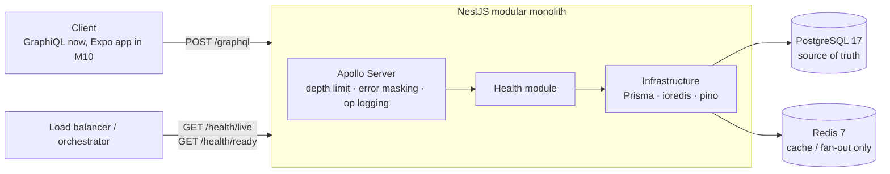

# Fintech Reliability Lab

A banking + investment platform built to practice the parts of financial systems that are easy to get wrong: double-entry ledgers, idempotent transfers, concurrency, real-time market data, event delivery guarantees, and session resilience.

Stack: **React Native (Expo) · NestJS · Apollo GraphQL · PostgreSQL · Prisma · Redis**, all TypeScript.

> Trading in this project is **simulated** (paper trading). Market data comes from public provider APIs and is always labelled with its source, timestamp, and freshness.

## Status

| Milestone | Scope | State |
|---|---|---|
| 1. Foundation | Monorepo, Postgres, Redis, NestJS, Apollo, config, logging, health, CI | ✅ |
| 2. Authentication | Registration, login, JWT, refresh token rotation, sessions | next |
| 3–12 | Ledger, transfers, market data, trading, outbox, subscriptions, mobile app, reliability | planned |

Each milestone only adds the modules it needs. There are no empty folders waiting for later features.

## Architecture (as of Milestone 1)



```text
apps/api/
  prisma/schema.prisma        # Prisma 7, client generated into src/generated (gitignored)
  schema.graphql              # generated from code, committed, checked in CI
  src/
    config/env.ts             # Zod-validated environment, fails at boot
    infrastructure/
      database/               # PrismaService (pg driver adapter)
      redis/                  # ioredis client, fail-fast, state-change logging
      logging/                # pino config, request-id resolution
    graphql/                  # cross-cutting only: config, error masking, logging plugin
    health/                   # liveness/readiness (REST) + health query (GraphQL)
  test/                       # integration tests against real Postgres/Redis
```

Domain modules (`identity`, `accounts`, `ledger`, …) will live under `src/modules/<name>/`, each owning its resolver, GraphQL types, use cases, and repositories.

## Key decisions

- **Code-first GraphQL with the generated SDL committed.** One source of truth, and every PR still shows the contract diff. [ADR 0001](docs/adr/0001-code-first-graphql.md)
- **Prisma, with raw SQL where locking matters.** Prisma's query API has no `SELECT … FOR UPDATE`. The ledger's critical path will use `$queryRaw` inside interactive transactions. [ADR 0002](docs/adr/0002-prisma-with-raw-sql-for-locking.md)
- **Node 24, CommonJS app on ESM-only Nest 12.** [ADR 0003](docs/adr/0003-node-24-and-module-format.md)
- **Redis is never the source of truth for money.** If Redis is down, only caching and real-time updates degrade.
- **Readiness ≠ liveness.** `/health/live` never checks dependencies, so a database outage takes the instance out of rotation instead of making it restart over and over.

## Observability and safety defaults

- Structured JSON logs (pino). Every line inside a request carries `req.id`, taken from a well-formed `x-request-id` header (`[A-Za-z0-9._-]{1,64}`) or generated, and echoed back in the response.
- Request logs keep only `id`, `method`, `url`, `statusCode`. Headers are not logged, and `authorization`, cookies, passwords and tokens are redacted as a second layer of protection.
- GraphQL returns HTTP 200 even when resolvers fail, so a plugin logs each operation's name, type, duration and error codes. Variables are never logged.
- Errors are whitelisted: unknown errors reach the client as `INTERNAL_SERVER_ERROR` with no message details. The original error is logged server-side.
- Query depth limit (configurable), introspection and GraphiQL disabled in production, Apollo CSRF prevention on.

## Local development

Requirements: Node 24 (`nvm use`), pnpm 12, Docker.

```bash
docker compose up -d                      # Postgres on :5433, Redis on :6379
cp apps/api/.env.example apps/api/.env
pnpm install                              # also generates the Prisma client
pnpm dev                                  # http://localhost:4000/graphql (GraphiQL)
```

```graphql
{ health { status database redis checkedAt } }
```

| Command | What it does |
|---|---|
| `pnpm test` | Unit + integration tests (needs `docker compose up`) |
| `pnpm typecheck` / `pnpm lint` | `tsc` / `oxlint --type-aware` |
| `pnpm --filter api prisma:migrate` | Create/apply migrations in dev |
| `pnpm --filter api prisma:deploy` | Apply committed migrations (CI/production) |

Tests always run against the `fintech_test` database and Redis DB `1`, never your dev data. `test/setup-env.ts` enforces this.

## Testing philosophy

Integration tests run against real Postgres and Redis. The financial milestones depend on database behavior (locks, isolation levels, constraints) that mocks can't reproduce. Dependency failures are tested too, e.g. readiness returns 503 when Redis is down.
