# Fintech Reliability Lab

A banking + paper-trading platform built to practise the parts of financial systems that are easy to get wrong: a double-entry ledger, idempotent transfers, row-level concurrency, real market data with honest freshness labels, a transactional outbox, GraphQL subscriptions, and session resilience on mobile.

**Stack:** React Native (Expo SDK 58) · Apollo Client 4 · NestJS 12 · Apollo Server 5 · PostgreSQL 17 · Prisma 7 · Redis 7. All TypeScript.

> **Trading is simulated.** No order ever reaches an exchange. Market data comes from public APIs (CoinGecko, Binance market-data endpoints, Twelve Data) and every price carries its source, timestamp and a freshness label (`LIVE`, `CACHED`, `DELAYED`, `STALE`).

| Sign in | Markets | Asset detail | Portfolio | Banking |
| --- | --- | --- | --- | --- |
| 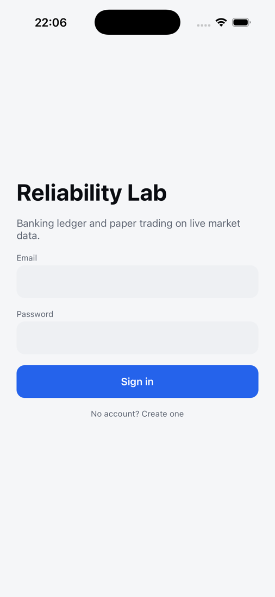 | 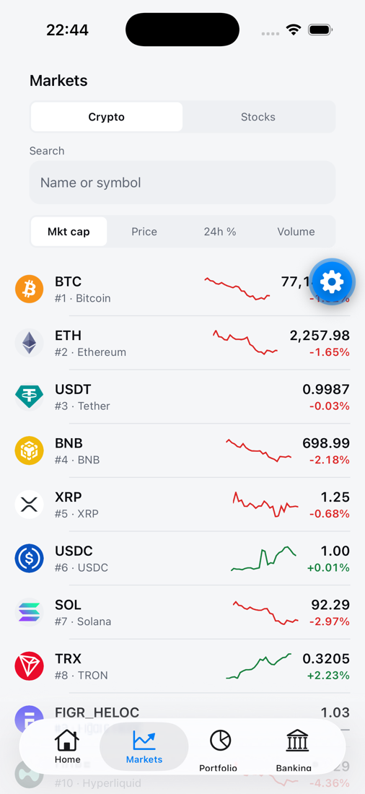 | 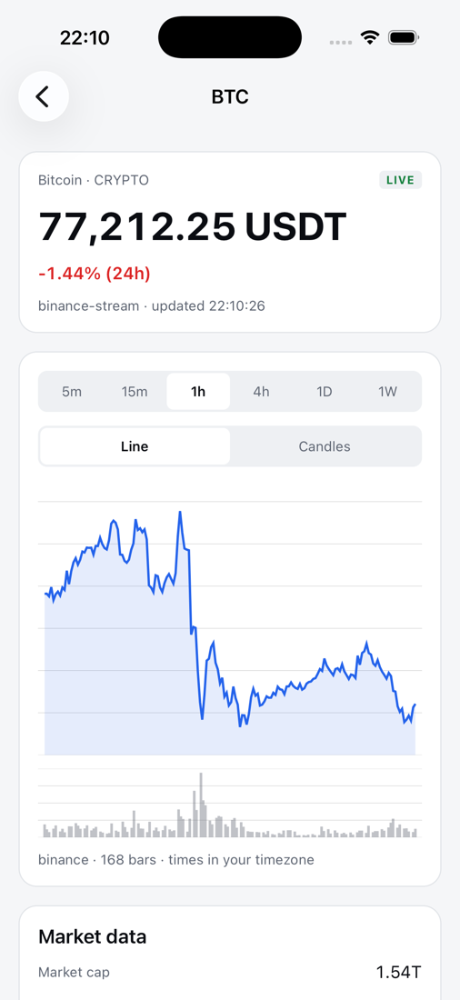 | 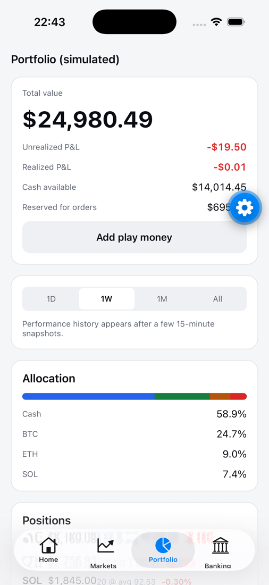 | 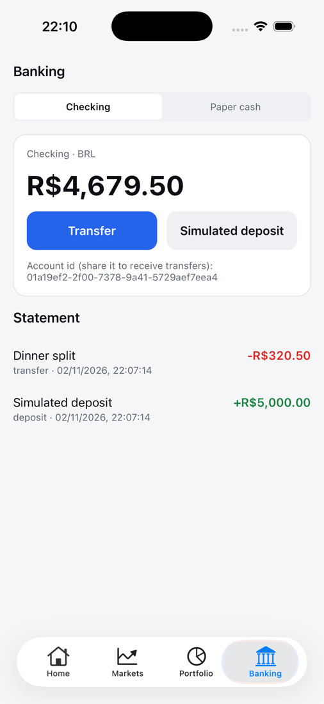 |

*iOS simulator, Expo Go, live market data, demo user (the round button on two shots is the Expo Go developer menu).*

## Contents

1. [What it does](#what-it-does)
2. [System architecture](#system-architecture)
3. [Backend modules](#backend-modules)
4. [Database schema](#database-schema)
5. [GraphQL API](#graphql-api)
6. [Ledger](#ledger)
7. [Transfers](#transfers)
8. [Market data](#market-data)
9. [Redis caching](#redis-caching)
10. [Simulated trading](#simulated-trading)
11. [Portfolio calculations](#portfolio-calculations)
12. [Events, outbox and subscriptions](#events-outbox-and-subscriptions)
13. [Authentication](#authentication)
14. [Mobile app](#mobile-app)
15. [Testing](#testing)
16. [Observability and security](#observability-and-security)
17. [Infrastructure](#infrastructure)
18. [Local development](#local-development)
19. [Decisions and known limits](#decisions-and-known-limits)

## What it does

| Banking | Investing (paper) |
| --- | --- |
| Sign up, sessions per device, revoke devices | Top 25 crypto assets + US stocks/ETFs with live or delayed prices |
| BRL checking account backed by a double-entry ledger | Line, candlestick and volume charts (5m to 1W), real provider candles only |
| Transfers between users, safe to retry (idempotency keys) | Watchlist, market overview, top gainers/losers, most traded |
| Simulated deposits (clearly labelled play money) | Market and limit orders filled against fresh market-data prices |
| Paginated statement with live updates | Positions, average cost, realized/unrealized P&L, allocation, performance history |

## System architecture

A modular monolith: one deployable API with strict module boundaries, plus background workers in the same process. Nothing here needs microservices yet.

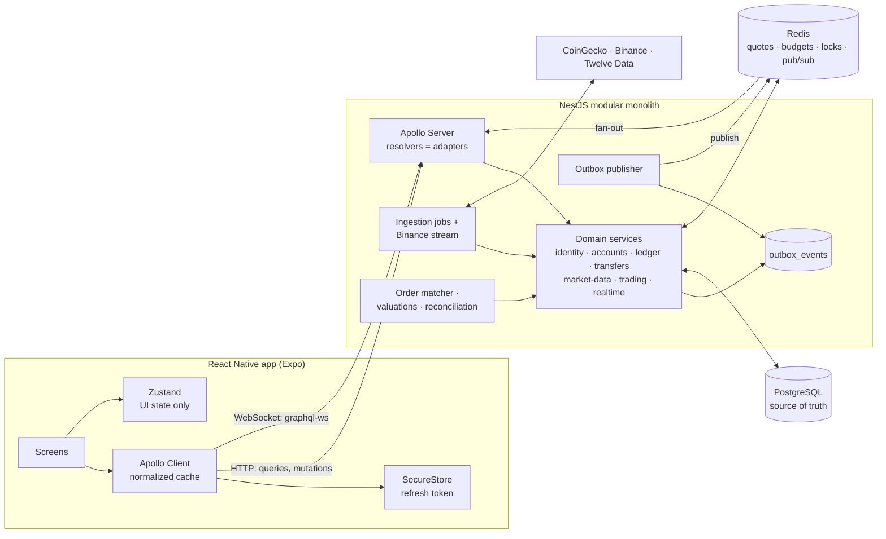

**Rule of thumb:** Postgres holds everything that must be right (money, orders, events). Redis holds what can be rebuilt (quotes, rate budgets, job locks, fan-out). If Redis dies, prices and live updates degrade; balances don't.

## Backend modules

```text
apps/api/src
  modules/
    identity/      registration, login, sessions, refresh rotation, auth guard
    accounts/      accounts, statements (keyset pagination)
    ledger/        LedgerService.post (the only way money moves), reconciliation
    transfers/     transfers + simulated deposits, idempotency
    market-data/   provider adapters, quote store, candles, ingestion jobs, DataLoaders
    trading/       portfolios, orders, positions, P&L, watchlists, matcher
    events/        outbox, publisher worker, event bus
    realtime/      GraphQL subscriptions, missed-event recovery
  infrastructure/  database (Prisma, transaction retry), redis, logging, jobs
  graphql/         config, error whitelist, pagination, WebSocket auth
  shared/          errors, money, uuidv7
```

Resolvers translate GraphQL ↔ services and hold no business rules. Authorization lives in the services (`WHERE id = $1 AND user_id = $viewer`), so another user's resource is indistinguishable from a missing one.

## Database schema

PostgreSQL is the source of truth. Prisma models plus hand-written SQL in the migrations for what Prisma can't express (CHECK constraints, triggers, deferred FKs, partial indexes).

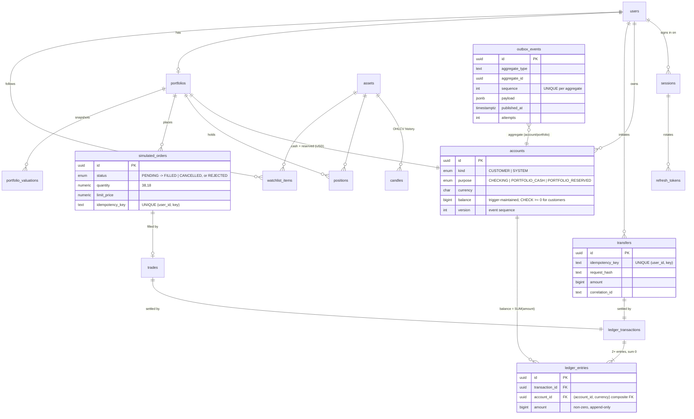

Every table uses UUIDv7 ids (time-ordered, index-friendly; also the keyset cursor). Migrations: `apps/api/prisma/migrations`.

## GraphQL API

Code-first schema; the generated SDL ([`apps/api/schema.graphql`](apps/api/schema.graphql)) is committed and CI fails on drift. The mobile app's types are generated from it, so CI also fails if a server change breaks the client.

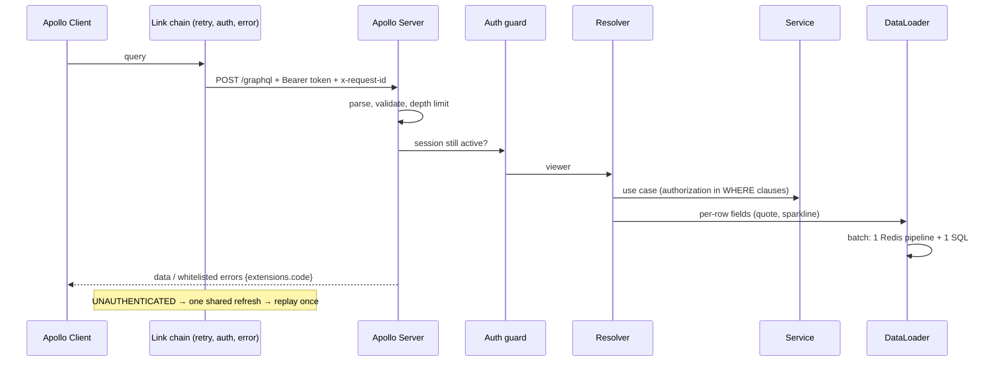

- **Exact decimals:** a `Decimal` scalar (string on the wire, validated both ways) for every amount, price, quantity and percentage, e.g. `Money { amount: Decimal, currency }`. GraphQL `Float` would be binary floating point, `Int` is 32-bit.
- **Errors:** expected failures carry stable codes (`INSUFFICIENT_FUNDS`, `IDEMPOTENCY_KEY_REUSED`, `NOT_FOUND`, …). Anything else becomes `INTERNAL_SERVER_ERROR`, on HTTP and WebSocket alike.
- **Limits (HTTP 400, never 500):** query depth (fragments flattened), query **cost** (objects weigh more than scalars, multiplied by depth), at most 15 aliases. Plus page sizes ≤ 100, ≤ 1000 candles per request, ≤ 50 assets per price subscription. A test runs every operation the mobile app sends through these rules.

## Ledger

Every movement is a ledger transaction with ≥ 2 entries summing to zero per currency. Amounts are `BIGINT` minor units (centavos). Postgres enforces the rules itself, so an application bug fails loudly instead of corrupting money. [ADR 0005](docs/adr/0005-double-entry-ledger.md)

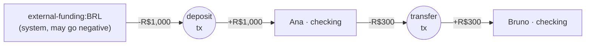

| Invariant | Enforced by |
| --- | --- |
| Customer balance never negative | `CHECK` on `accounts`; balance maintained by an insert trigger (`balance = balance + amount`) |
| Every transaction balances, ≥ 2 entries | Deferred constraint triggers, checked at `COMMIT` |
| Ledger is append-only | Triggers reject `UPDATE`/`DELETE`/`TRUNCATE`; fixes are reversal transactions |
| Entry currency = account currency | Composite FK `(account_id, currency)` |
| Cached balance = sum of entries; ledger sums to 0 | `verifyIntegrity()`: hourly job + `pnpm --filter api ledger:verify` |

## Transfers

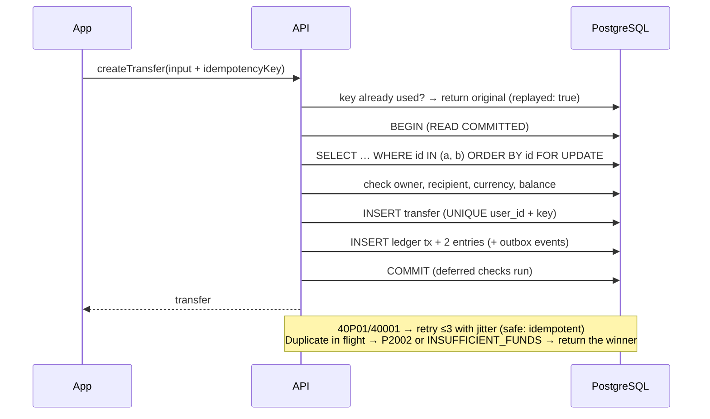

- **Ordered locks** (sorted ids, one statement) make A→B / B→A deadlocks impossible. Removing the ordering in a mutation test produced 24 deadlock retries and a failing test.
- **Two R$800 withdrawals from R$1,000:** one succeeds, one gets `INSUFFICIENT_FUNDS`. An application-only balance check would let both read R$1,000 and pass.
- Same key + different request → `IDEMPOTENCY_KEY_REUSED`.

Details: [ADR 0006](docs/adr/0006-transfers-and-idempotency.md)

## Market data

| Provider | Used for | Key |
| --- | --- | --- |
| CoinGecko public API | Top-N listings, market cap, volume, global stats | none (optional demo key) |
| Binance market data (`data-api.binance.vision`, `data-stream.binance.vision`) | Live prices (WebSocket), candles; quotes in **USDT** | none |
| Twelve Data | Stocks/ETFs (SPY, QQQ as index stand-ins); quotes labelled `DELAYED` | free key; without it only AAPL |

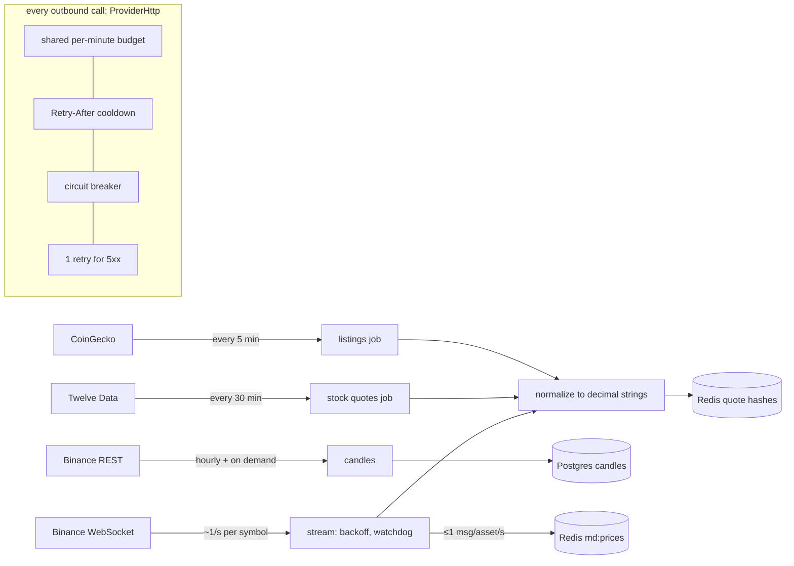

Live price subscription lifecycle:

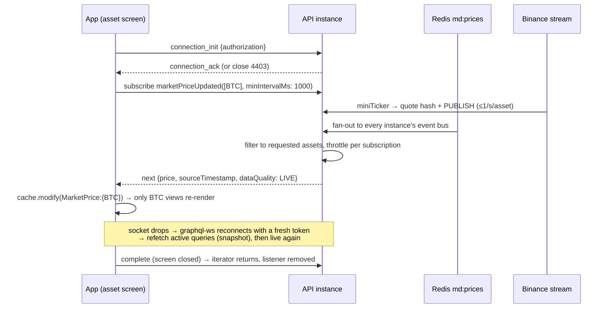

- **No request ever proxies to a provider.** GraphQL reads Redis/Postgres. Charts refresh missing candles on demand with a cross-instance cooldown, so 10 users opening a chart = 1 upstream call.
- **Freshness is computed when read**, from timestamps: `LIVE` (streamed, ≤ 30s), `CACHED` (polled), `DELAYED` (stocks), `STALE` (past its window). A dead job can't leave "fresh" labels behind.
- **Nothing is invented.** Assets without a candle provider show no chart; gaps are reported (`isComplete: false`), never filled. Provider down → stored candles with `isStale: true` and a note.

Details and provider limits: [ADR 0007](docs/adr/0007-market-data-providers-and-ingestion.md)

## Redis caching

Redis holds only what can be rebuilt; balances are always read from Postgres.

| Key | Holds | Lifetime | Written by |
| --- | --- | --- | --- |
| `md:quote:{assetId}` (hash) | price, 24h change, volume, market cap, provider, timestamps | 24h TTL; freshness judged from timestamps at read time | listings job, stock job, Binance stream |
| `md:overview` (hash) | total crypto market cap, BTC dominance | overwritten every listings run | listings job |
| `md:candles:refresh:{asset}:{tf}` | "someone is already fetching this chart" | 15s to 15 min, by timeframe | chart queries |
| `md:provider:{name}:budget:{minute}` | calls made this minute | 2 min | every provider call |
| `md:provider:{name}:cooldown` | provider said 429 | `Retry-After` (default 60s) | provider client |
| `job:lock:{job}` | one instance runs a job per interval | interval − 1s | job runner |
| `auth:login-failures:{sha256(email)}` | failed logins | 15 min | login |
| channels `md:prices`, `events:account`, `events:portfolio` | live fan-out | pub/sub, not stored | stream, outbox publisher |

Freshness windows and refresh intervals are env-configurable (`QUOTE_LIVE_MAX_AGE_SECONDS`, `CRYPTO_QUOTE_STALE_AFTER_SECONDS`, `STOCK_QUOTE_STALE_AFTER_SECONDS`, `TRADE_MAX_PRICE_AGE_SECONDS`, `*_INTERVAL_SECONDS`) so they can follow a provider plan.

**Volatility indicators.** Realized volatility per asset, computed in one SQL statement from stored hourly candles: the standard deviation of hourly log returns, annualized by √8760 (24/7 markets). Reported for 24h and 7d, with the 24h high–low range. It is `null` below 12 (24h) or 48 (7d) hourly returns. This describes the past, not a forecast.

## Simulated trading

Each portfolio owns two USD ledger accounts (available cash, reserved for limit buys) whose counterparty is `simulated-market:USD`. Positions store quantity (18 decimals), reserved quantity, cost basis and realized P&L.

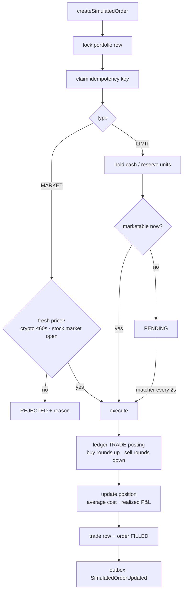

Every order carries `isSimulated: true` and a disclaimer: fills in full at the latest market-data price, with no spread, slippage, fees, partial fills or order book, and USDT counted as USD.

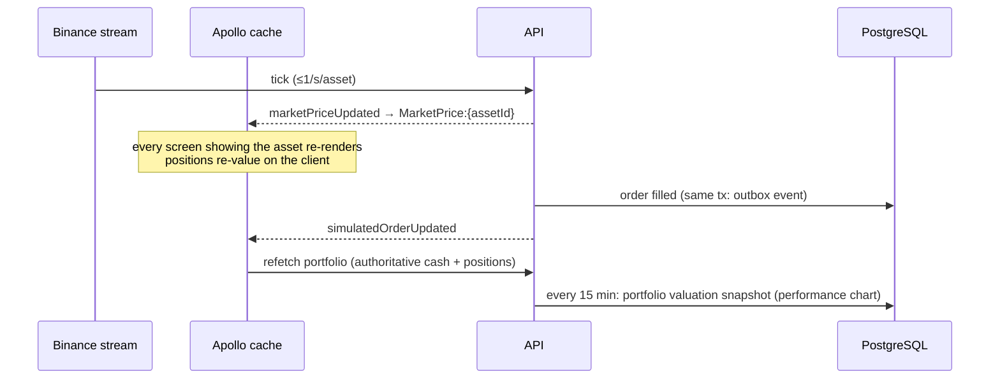

Details: [ADR 0008](docs/adr/0008-simulated-trading.md)

## Portfolio calculations

All in decimal arithmetic (decimal.js); cash in integer cents.

| Figure | Formula |
| --- | --- |
| Buy cost / sell proceeds | `ceil(qty × price × 100)` / `floor(qty × price × 100)` cents |
| Average price | `cost basis / quantity` (average-cost method) |
| Cost of units sold | `cost basis × sold / quantity` (all of it when the position closes, so no dust) |
| Realized P&L (per sell) | `proceeds − cost of units sold` |
| Market value | `quantity × latest price` (flagged stale if the price is) |
| Unrealized P&L | `market value − cost basis` |
| Total value | `available cash + reserved cash + Σ market value` |
| Total return % | `(total value − net simulated deposits) / net deposits × 100` |
| Holdings, last 24h | `Σ (market value − market value / (1 + 24h change))`; null if any change is unknown |
| Allocation % | `market value (or cash) / total value × 100` |

## Events, outbox and subscriptions

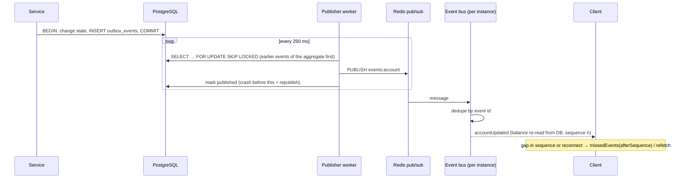

- **Delivery is at-least-once** from the outbox (consumers dedupe on `id`) and **at-most-once** over Redis pub/sub (hence `missedEvents` from the durable table). There is no exactly-once claim.
- Failed publishes back off exponentially and are dead-lettered after 12 attempts. One stuck event blocks only its own aggregate.
- **WebSocket auth:** the token goes in `connectionParams`, never the URL. The session is re-checked every 60s; a revoked session is closed with `4401` and the app refreshes and reconnects.
- `marketPriceUpdated` streams only requested assets, throttled per subscription (≈1s detail screen, 3–5s lists).

Details: [ADR 0009](docs/adr/0009-transactional-outbox.md), [ADR 0010](docs/adr/0010-graphql-subscriptions.md)

## Authentication

Server-side sessions with short-lived JWT access tokens and single-use, rotating refresh tokens. Details and trade-offs: [ADR 0004](docs/adr/0004-sessions-and-refresh-token-rotation.md).

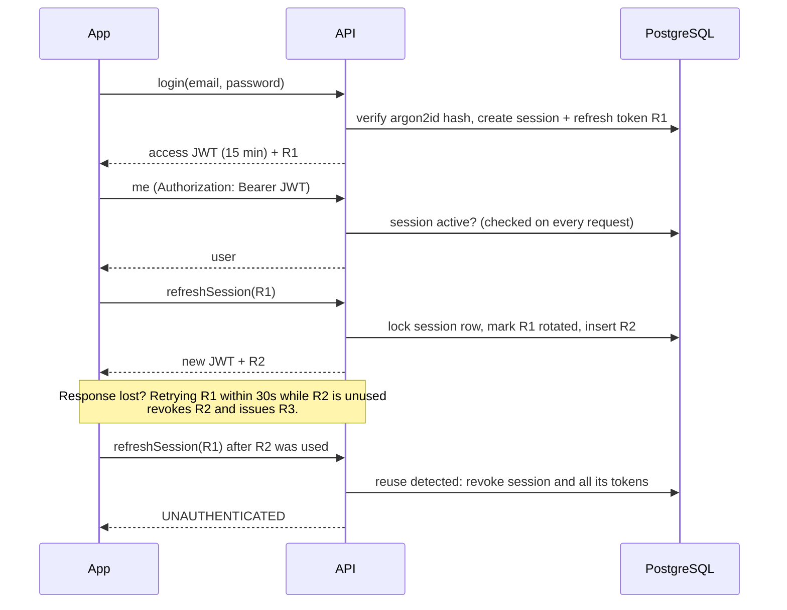

| Guarantee | Enforced by |
|---|---|
| Logout/revoke takes effect immediately | Session check on every request |
| One live refresh token per session | Row lock **and** a partial unique index |
| Replayed refresh token kills the session | Rotation history + reuse detection |
| No duplicate accounts (`A@x.com` vs `a@x.com`) | Normalization **and** a `CHECK (email = lower(email))` constraint |
| Unknown email and wrong password look identical | Same error, dummy argon2 verify for unknown emails |
| Online password guessing is slowed | 5 failures / 15 min per account (Redis, fails open) |
| New resolvers are protected by default | Global guard, opt out with `@Public()` |

Expected failures are `AppError`s with a stable `extensions.code` (`INVALID_CREDENTIALS`, `EMAIL_TAKEN`, `UNAUTHENTICATED`, …), which the app switches on. Anything else reaches the client as `INTERNAL_SERVER_ERROR`.

On the client, a `SessionManager` keeps the access token in memory and the refresh token in SecureStore (Keychain, this device only). Concurrent `UNAUTHENTICATED` responses share **one** refresh, then each operation is replayed once. Network errors during a refresh keep the token, because the server's 30s grace window makes retrying safe.

## Mobile app

`apps/mobile`, Expo Router with native tabs. Runs in Expo Go. [ADR 0011](docs/adr/0011-mobile-app-architecture.md)

| Concern | Choice |
| --- | --- |
| Server state | Apollo Client 4: normalized cache, `cache-and-network` by default, cursor pagination merges, subscriptions written into `MarketPrice:{assetId}` |
| Types | GraphQL Code Generator (client preset) from the API's committed SDL |
| UI state | Zustand (timeframe, chart mode, market tab and sort), read with selectors; server data is never copied into it |
| Forms | React Hook Form + Zod, mirroring server rules |
| Charts | Victory Native 42 on Skia: line, area, candlestick, volume bars; pinch-zoom and pan on time, long-press crosshair with the exact candle; 1m to 1M (only timeframes the provider offers); data downsampled for display |
| Styling | styled-components with light/dark theme tokens |
| Retries | Queries on network errors; mutations only if they carry an idempotency key; one key per user intent, rotated after success |
| Money in the UI | Formatted from strings; never parsed into floats (only chart pixels use numbers) |
| Not used | TanStack Query and Axios: there is no REST integration that would justify them |

Financial results are never optimistic: a transfer or order shows as done only after the server commits. The watchlist uses an optimistic response because it isn't money.

## Testing

| Layer | What | Where |
| --- | --- | --- |
| API unit | money parsing, ledger balancing, order math, provider normalizers (recorded real responses), refresh decisions, retry policy | `apps/api/src/**/*.spec.ts` |
| API integration | real Postgres + Redis: concurrency (withdrawals, opposing transfers, duplicate keys, concurrent orders, concurrent refresh), DB invariants via raw SQL, provider failures against a fake HTTP server, outbox retry/ordering/dead letters, WebSocket subscriptions and authorization | `apps/api/test/*.e2e.spec.ts` |
| Journey | the spec's 18-step end-to-end scenario against a running server | `apps/api/test/full-flow.e2e.spec.ts` |
| Mobile | single-flight refresh, exact money formatting, pagination merge, freshness badge rendering | `apps/mobile/src/**/__tests__` |
| Performance | N+1 vs DataLoader, index vs none, hot-account contention | `pnpm --filter api bench`, [docs/performance.md](docs/performance.md) |

Several tests were **mutation-tested**: the guard was removed to prove the test fails (the refresh-session lock, the overdraft `CHECK`, ordered locking), then restored.

CI (GitHub Actions) runs typecheck, lint, all API and mobile tests against Postgres and Redis service containers, and both schema drift checks.

## Observability and security

- **Structured logs (pino)** with a request id on every line, echoed as `x-request-id` and stored as `correlation_id` on transfers, orders and outbox events.
- **Prometheus metrics** at `GET /metrics` (optionally behind `METRICS_TOKEN`). Labels come only from closed sets (schema field names, providers, error codes), never user data.

| Metric | Covers |
| --- | --- |
| `graphql_operation_duration_seconds{type,outcome}` | request duration and failures |
| `graphql_resolver_duration_seconds{field}` | root Query/Mutation fields |
| `db_query_duration_seconds` | every SQL statement Prisma issues |
| `dataloader_batch_size{loader}` | batching effectiveness |
| `ws_connections`, `ws_disconnects_total` | subscription connections |
| `market_provider_request_duration_seconds{provider,outcome}`, `market_provider_rate_limited_total{provider,reason}` | provider latency, 429s, local budget/cooldown/circuit refusals |
| `market_stream_seconds_since_last_message` | live-feed freshness |
| `outbox_pending_events`, `outbox_oldest_pending_age_seconds`, `outbox_dead_lettered_events`, `outbox_published_total`, `outbox_publish_failures_total` | event pipeline health and delay |
| `event_recovery_requests_total{stream}` | clients catching up after reconnects |
| `auth_failures_total{reason}`, `auth_refresh_attempts_total{outcome}` | login failures, throttling, refresh rotations, reuse detection |
| `financial_operation_failures_total{operation,code}` | rejected transfers, deposits, orders |
- **Logged:** GraphQL operation name, type, duration and error codes; provider latency, 429s, circuit state; outbox backlog; job durations; WebSocket connection counts.
- **Never logged:** variables, tokens, passwords, balances. Redaction is a second layer of protection.
- **Health:** `/health/live` (process only) vs `/health/ready` (Postgres + Redis with timeouts).
- **Production hardening:** introspection and GraphiQL off, CSRF prevention, depth limit, internal errors masked.
- **Configuration:** env validated with Zod at boot (fails without echoing values). The dev JWT secret is refused in production. Provider keys are optional and never committed.

## Infrastructure

- **Docker Compose:** Postgres 17 (dev database + a separate `fintech_test` database) and Redis 7, with health checks. The API runs on the host in development.
- **Migrations:** Prisma migrations with hand-written SQL appended (triggers, CHECKs, deferred FKs); `prisma migrate diff` stays empty, so Prisma never drops them.
- **Configuration:** one Zod schema validates the env at boot. Every variable is documented in `apps/api/.env.example`; secrets and provider keys are never committed.
- **CI (GitHub Actions):** install with a frozen lockfile → typecheck → lint → API and mobile tests against Postgres/Redis service containers → GraphQL schema drift check → mobile codegen drift check.
- **Supply chain:** pnpm with an explicit allowlist for install scripts (`allowBuilds`, telemetry denied) and a minimum release age for new versions.
- **Docs:** OpenAPI (Swagger UI at `/docs` outside production) for the REST health endpoints; GraphQL SDL committed in `apps/api/schema.graphql`.

## Local development

Requirements: Node 24 (`nvm use`), pnpm 12, Docker; Xcode or Android Studio for the app (or Expo Go on a device).

```bash
docker compose up -d                      # Postgres :5433, Redis :6379
cp apps/api/.env.example apps/api/.env    # optional: add TWELVE_DATA_API_KEY for more stocks
pnpm install
pnpm --filter api prisma:migrate          # apply migrations to the dev database
pnpm dev                                  # API on http://localhost:4000/graphql

cd apps/mobile
EXPO_PUBLIC_API_URL=http://localhost:4000 npx expo start   # press i for iOS simulator
```

On a physical device, use your computer's LAN IP in `EXPO_PUBLIC_API_URL`.

| Command | What it does |
| --- | --- |
| `pnpm test` | API + mobile tests (needs `docker compose up`) |
| `pnpm typecheck` / `pnpm lint` | `tsc` everywhere / `oxlint --type-aware` on the API |
| `pnpm --filter api bench` | Performance experiments (prints a markdown table) |
| `pnpm --filter api ledger:verify` | Reconcile the ledger; exit 1 on drift (run after `pnpm --filter api build`) |
| `pnpm --filter mobile codegen` | Regenerate app types from `apps/api/schema.graphql` |

Tests use the `fintech_test` database and Redis DB 1, never your dev data, and never call real market-data providers.

## Decisions and known limits

Architecture Decision Records live in [`docs/adr`](docs/adr):

| ADR | Decision |
| --- | --- |
| [0001](docs/adr/0001-code-first-graphql.md) | Code-first GraphQL, committed SDL |
| [0002](docs/adr/0002-prisma-with-raw-sql-for-locking.md) | Prisma, raw SQL where locking matters |
| [0003](docs/adr/0003-node-24-and-module-format.md) | Node 24, CommonJS app on ESM-only Nest 12 |
| [0004](docs/adr/0004-sessions-and-refresh-token-rotation.md) | Server-side sessions, rotating refresh tokens |
| [0005](docs/adr/0005-double-entry-ledger.md) | Double-entry ledger with DB-enforced invariants |
| [0006](docs/adr/0006-transfers-and-idempotency.md) | Idempotency keys and ordered row locks |
| [0007](docs/adr/0007-market-data-providers-and-ingestion.md) | Providers, freshness, ingestion |
| [0008](docs/adr/0008-simulated-trading.md) | Paper-trading engine |
| [0009](docs/adr/0009-transactional-outbox.md) | Transactional outbox, at-least-once |
| [0010](docs/adr/0010-graphql-subscriptions.md) | graphql-ws subscriptions |
| [0011](docs/adr/0011-mobile-app-architecture.md) | Mobile app architecture |
| [0012](docs/adr/0012-spec-deviations.md) | Where and why the code differs from the brief |

**Known limits (deliberate, documented):**
- No per-IP rate limits, JWT key rotation, email verification, or "password change revokes other sessions" yet.
- Recipients are addressed by account id (a real bank uses an account number or key plus a name-confirmation step).
- `simulated-market:USD` is a hot row: trades across all users serialize on it.
- In-process workers; move them to a separate process or queue when isolation matters. Scheduled jobs take a Redis lock per run, but each instance with `MARKET_INGESTION_ENABLED=true` opens its own Binance stream: enable ingestion on one instance.
- No distributed tracing (OpenTelemetry), no network load test (k6), no on-device React Native profiling yet.
- The GraphQL depth/cost/alias limits apply to HTTP. WebSocket subscriptions rely on their own argument limits (≤ 50 assets, ownership checks).
- Alpha Vantage, Financial Modeling Prep and Yahoo Finance were evaluated but not integrated: free tiers that are too small, or no official API ([ADR 0007](docs/adr/0007-market-data-providers-and-ingestion.md)).
- Stock coverage depends on a free Twelve Data key; Binance prices are USDT, treated as USD for paper trading.
